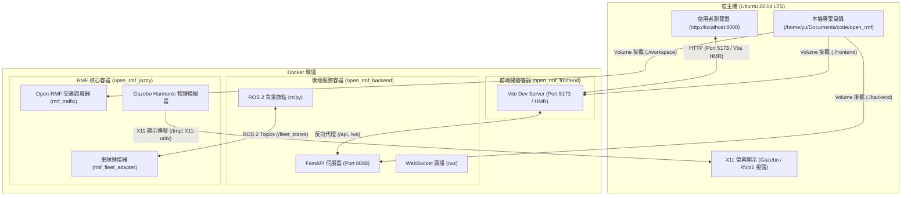
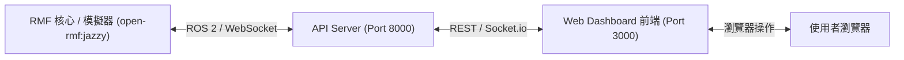
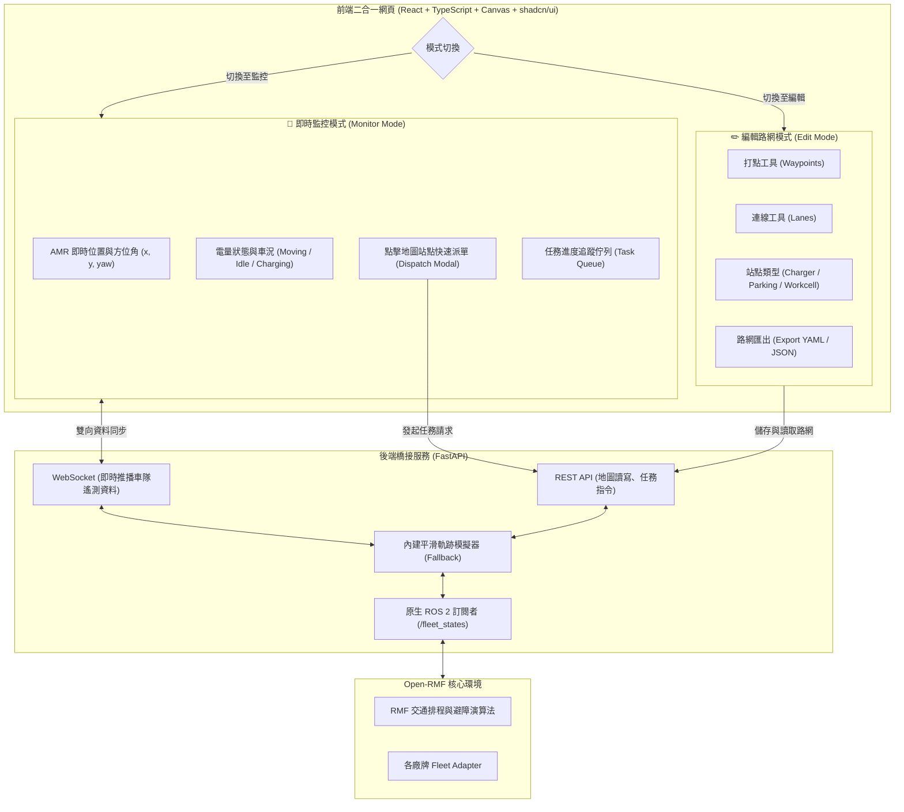
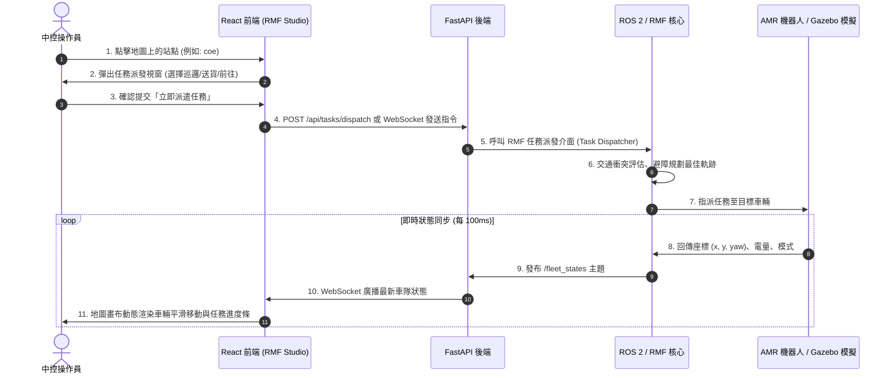

# Open-RMF Web Studio 系統架構文檔

本文檔說明本專案的整體系統架構、前後端整合設計、Docker 容器掛載關係，以及 Open-RMF 的資料通訊流。

跨樓層派車與 Isaac Sim 電梯／導航整合，請參閱 [跨樓層派車、電梯互動與導航換圖流程](cross_floor_elevator_flow.md)，內含完整時序圖、進梯準備與目的層重定位細節。

---

## 車端已上線但監控畫面沒有車輛

`GET /api/discovered-robots` 的 `connection_status: online` 代表 MQTT 心跳正常；
監控畫面使用的 `GET /api/robots` 與 `/ws/fleet` 則來自 RMF 的 `/fleet_states`。
若前者有車、後者為空，需檢查 RMF 排程器與車輛納管，而不是只重啟 Isaac Sim。

排程器與任務派遣器的 stdout/stderr 繼承後端輸出，可用
`docker compose logs --tail 100 backend` 查看。不要改成未持續讀取的
`subprocess.PIPE`：日誌填滿 pipe 後，ROS executor 會卡在 `pipe_write`，
造成註冊無法完成、車端仍有 MQTT 心跳但 `/fleet_states` 沒有車輛。
修正後須重新啟動後端使核心程序使用新設定；重啟前先確認沒有執行中的任務。

## Fleet Adapter 路網診斷與 UI 警示

Fleet Adapter 透過 `/rmf/fleet_adapter_state` 回報已成功註冊車隊的路網編號、
路網檔案內容雜湊及站點名稱，以及車輛充電點／停車點 fallback 警告。
後端將這些執行時資料與磁碟上的路網比較，透過
`GET /api/fleet-adapters` 的 `diagnostics` 欄位提供給 UI；診斷不會寫入車隊設定檔。

| 狀態 | 意義與操作 |
| --- | --- |
| `ok` | Adapter 回報的路網版本與目前儲存版本一致。這不代表任務一定能完成。 |
| `stale` | 已存路網或指派路網與 Adapter 載入版本不同，或車隊尚未載入。至車隊管理頁按「重新載入 Adapter」。 |
| `unknown` | 尚未收到狀態、超過 5 秒未更新，或無法比對路網版本。先檢查 Adapter 與 ROS 2 連線，不視為健康。 |

UI 每 5 秒更新診斷。車隊管理卡片顯示路網警示、一鍵重新載入及
「設定充電點／停車點不在路網，實際改用哪個點」；路網編輯頁也會提示尚未套用的新路網。
自動存檔只儲存路網，**不重啟 Adapter**；按「儲存路網」才會要求重新載入。
重新載入作用於共享的 MQTT Fleet Adapter 程序，會影響所有車隊，請避免在任務執行中操作。

REST 與 WebSocket 派遣共用相同檢查：若有新鮮的 Adapter 路網回報，
指定車隊必須載入所需站點，自動指派則必須有同一個未暫停車隊涵蓋全部任務站點。
不符合時，在送給 RMF 前回傳明確原因；若缺少或過期的路網回報，交由 RMF 判斷，不使用過期資料阻擋任務。
此檢查不驗證路徑可達性、電量、車輛可用性或競標結果；RMF 後續失敗原因仍會顯示於任務卡片。

## 一、系統整體架構 (System Overview)

本系統整合了 **Open-RMF 核心調度引擎**、**FastAPI 後端橋接服務** 與 **React + shadcn/ui 前端互動介面**，前後端皆掛載於同一個 ROS 2 Jazzy Docker 環境中。

---

## 二、Open-RMF 官方標準架構 vs 本專案整合架構

### 1. 官方標準前後端分離架構
在 Open-RMF 官方標準設計中，核心與 Web 是分離的微服務：

### 2. 本專案「編輯 + 監控二合一」整合架構
為解決官方 Web 只能監控、無法線上拉線標點的限制，本專案將**「路網編輯器 (Graph Editor)」**與**「即時監控派單中心 (Fleet Monitor)」**整合至單一 Web 應用中：

---

## 三、任務派遣與資料流序向圖 (Sequence Diagram)

以下展示中控人員於網頁端點選地圖進行「任務派遣」至車輛實際移動的完整資料生命週期：

---

## 三之一、Backend ↔ Fleet Adapter ROS 2 介面

Backend 不直接與車端（MQTT）通訊；所有車端互動皆經由 Fleet Adapter（FA）轉送。Backend 與 FA 之間使用以下 `std_msgs/String`（JSON payload）主題：

| Topic | 方向 | QoS | Payload | 說明 |
|---|---|---|---|---|
| `/rmf/fleet_control` | Backend → FA | depth 10 | `{"action":"pause"\|"resume","fleet":"fleet1"}` | 車隊暫停/恢復。Backend 每秒重送直到 `/rmf/fleet_adapter_state` 反映結果（逾時約 4 秒即回報失敗）。 |
| `/rmf/discovered_robots` | FA → Backend | depth 10 | `{"<fleet>_<robot>": {fleet_name, robot_id, status, last_seen, specs, ...}}` | 車端註冊/心跳/離線狀態；Backend 以此判定 `offline`，並將 `specs`（footprint/速度）寫回 `fleet_adapters.json`。 |
| `/rmf/fleet_adapter_state` | FA → Backend | depth 1, RELIABLE, TRANSIENT_LOCAL | `{"mqtt_connected":bool,"paused_fleets":[...],"estopped_robots":["fleet/robot",...],"timestamp":float}` | FA 執行狀態，每 1.5 秒及變更時發布；作為 pause/resume 的確認，以及 `/api/discovered-robots` 的 `mqtt_connected` 來源（超過 5 秒未更新視為斷線）。 |

> [!NOTE]
> 相機清單、RTSP 串流開關與雲台旋轉（Pan / Tilt）全面採用獨立 MQTT 介面（見 [camera_mqtt_control.md](camera_mqtt_control.md)），不經由 ROS 2 或 Fleet Adapter。

`saved_maps/paused_fleets.json`、`saved_maps/estopped_robots.json` 僅由 FA 寫入；Backend 的暫停/緊急停車狀態一律鏡像自 `/rmf/fleet_adapter_state`。

任務取消使用 Open-RMF 標準 Task API：Backend 於 `/task_api_requests` 發布 `{"type":"cancel_task_request","task_id":"<RMF booking id>"}`，由擁有該任務的 fleet adapter 回覆於 `/task_api_responses`（多個 adapter 可能回覆，任一 `success:true` 即成功）。

### 任務取消與緊急停車 REST API

| Method & Path | Body | 說明 |
|---|---|---|
| `POST /api/tasks/{task_id}/cancel` | – | 取消佇列中或執行中的任務。`task_id` 可為本地 id、request id 或 RMF booking id。佇列中的任務直接移除；執行中的任務由 RMF 經 FA 對車端下發 `stop`。成功後任務狀態為 `canceled`。已結束的任務、或尚未取得 RMF booking id（仍在競標）的任務回傳 error。 |
| `POST /api/robots/{robot_id}/emergency-stop` | `{"fleet_name"?: str, "cancel_task"?: bool}` | 立即對車端下發 `stop`，並將車輛自 RMF 退役（不接新任務）；RMF 後續對該車的指令一律暫扣不下發。`cancel_task: true` 時同時取消該車目前任務（結果在 `cancel_result`）。狀態持久化，FA 重啟後仍維持。 |
| `POST /api/robots/{robot_id}/emergency-stop/release` | `{"fleet_name"?: str}` | 解除緊急停車；若原任務仍有效，FA 會以新 `cmd_id` 重新下發被中斷的指令，車輛繼續執行。 |
| `POST /api/emergency-stop` | `{"cancel_task"?: bool}` | 全部車輛緊急停車，回傳 `results`（每台的結果）。 |
| `POST /api/emergency-stop/release` | – | 解除所有緊急停車中的車輛。 |

回應格式：`{"status":"success"|"error","message":str,...}`；FA 未在時限內確認時回傳 `status:"error"` 且狀態不變。
`/api/robots` 與 WebSocket `fleet_states` 中的車輛包含 `status`（`idle`/`moving`/`charging`/`paused`/`offline`/`emergency_stop`）、`emergency_stop: bool`、`online: bool`、`task_id`。緊急停車中的車輛無法指定派車（`/api/tasks/dispatch` 回傳 error）。

---

## 四、目錄結構與 Docker 掛載映射

專案所有程式碼皆置於宿主機，透過 Docker Compose 雙向 Volume 掛載至容器內部：

| 宿主機路徑 | 容器內掛載路徑 | 說明 |
| :--- | :--- | :--- |
| `./backend` | `/root/rmf_ws/backend` | FastAPI 後端伺服器與 ROS 2 橋接程式 |
| `./frontend` | `/root/rmf_ws/frontend` | React + Vite 前端原始碼與建置產物 (`dist/`) |
| `./workspace` | `/root/rmf_ws/src/custom_ws` | 自訂 ROS 2 節點、自製 Fleet Adapter 或地圖設定檔 |
| `/tmp/.X11-unix` | `/tmp/.X11-unix` | X11 畫面通道（支援 Gazebo 與 RViz2 視窗顯示） |

### 服務埠號 (Ports)
- **`8000`**：FastAPI 後端 API、WebSocket 伺服器與 React 前端託管入口 (`http://localhost:8000`)
- **`5173`**：Vite 開發伺服器（於宿主機執行 `npm run dev` 時使用）

---

## 五、路網持久化與 SLAM 底圖儲存機制 (Map Persistence & SLAM Map)

本系統具備完整的伺服器端與本地雙層持久化機制，編輯好的路網不會因網頁重新整理或容器重啟而遺失：

1. **路網持久化檔案 (`./backend/saved_maps/`)**：
   - **`active_nav_graph.json`**：保留完整頂點、路徑與前端介面屬性，供前端開機自動載入。
   - **`active_nav_graph.yaml`**：自動即時轉譯為標準 Open-RMF Building Map 規格（包含 `vertices`、`lanes`、`is_charger`、`is_parking_spot`、`is_workcell` 等屬性），可直接作為 Open-RMF 導航排程器與 Fleet Adapter 的輸入檔。
2. **SLAM 雷達底圖存儲 (`./backend/uploads/`)**：
   - 上傳的 `.pgm` 與 `map.yaml` 會自動轉譯為 PNG 與空間解析度參數，並與 YAML 中的 `drawing.filename` 關聯。
3. **前端自動恢復與快取機制**：
   - 當瀏覽器載入時，自動向 `GET /api/map` 請求最新儲存的路網；若離線則以 `localStorage` 雙層容災載入。
   - 點擊頂部導航列「💾 儲存路網」即可一鍵寫入硬碟並透過 WebSocket 廣播更新至所有連線用戶端。

---

## 六、前後端分離開發工作流 (Decoupled Development Workflow)

為了提供最流暢的開發體驗，系統支援前後端獨立運作的模式：

1. **後端服務 (Backend Service)**：
   - 運行於 Docker 容器內，提供 FastAPI REST API 與 WebSocket 車隊資料串流 (`http://localhost:8000`)。
2. **前端服務 (Frontend Vite Dev Server)**：
   - 運行於本機 Node.js 環境 (`http://localhost:5173`)，具備秒級熱模組替換 (HMR)。
   - 任何在 VS Code 中的程式碼修改（UI、樣式、狀態邏輯）存檔後瞬間在瀏覽器呈現，**完全不需執行 `npm run build`**。
3. **透明反向代理 (Reverse Proxy)**：
   - 透過 `frontend/vite.config.ts` 中的 `proxy` 配置，前端送往 `/api` 與 `/ws` 的所有請求會自動無縫轉發至後端 Port `8000`，解決 CORS 跨來源問題。
4. **一鍵啟動腳本**：
   - 專案根目錄已建立 `./start_dev.sh`，執行即可同時確保後端 Docker 運行並啟動前端熱重載環境。
