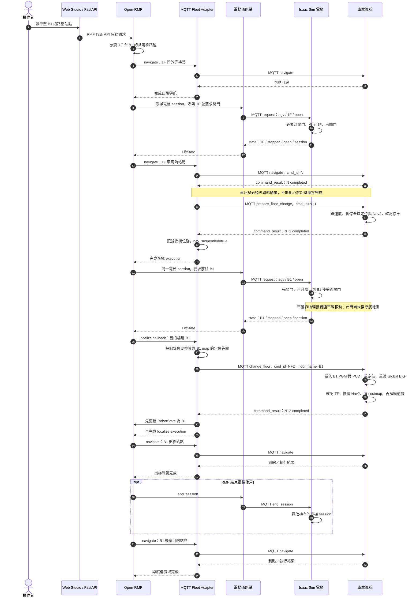
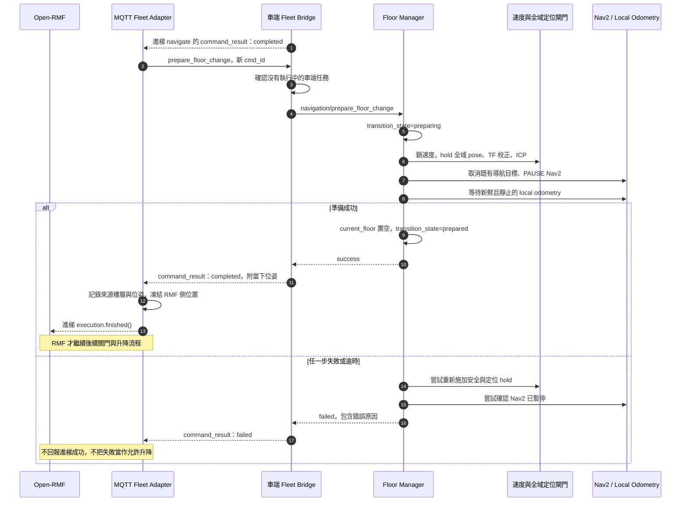
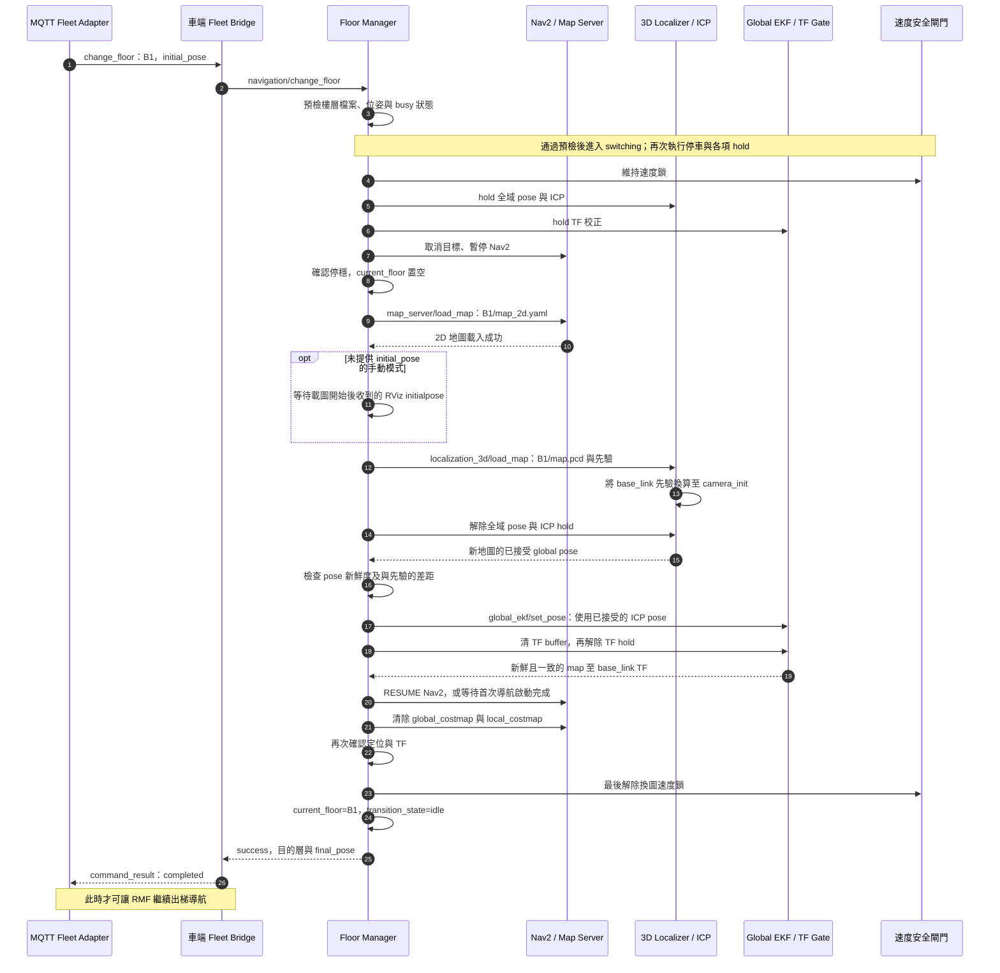

# 跨樓層派車、電梯互動與導航換圖流程

本文依據 `rmf_isaacsim` 與相鄰的 `isaacsim_fast-lio2-slam` 專案現有實作，說明車輛從 **1F 搭乘 lift_1 前往 B1 站點**的流程。反向回 1F 使用相同機制，只需交換出發與目的樓層。

**核心順序：進梯導航完成 → 車端準備完成 → 電梯升降並開門 → 換圖與重定位完成 → 出梯繼續導航。** 電梯抵達不代表導航地圖已切換；畫面顯示新底圖也不代表定位已就緒。

本文的自動流程已有對應程式碼，並非待開發設計；但程式與單元測試存在，**不等於本文已完成現場／完整 Isaac Sim 端到端驗證**。圖中的 RMF 電梯排程、session 管理與 `localize` 觸發屬於上游 Open-RMF 行為，本專案負責接入與完成回報。

## 1. 角色與分工

下文以 **RMF 專案**代表 `rmf_isaacsim`，以 **車端專案**代表 `isaacsim_fast-lio2-slam`。

| 角色 | 所屬與實作 | 責任 |
| --- | --- | --- |
| Web Studio／FastAPI | RMF 專案：`backend/controller/fleet_controller.py`、`backend/rmf_service.py` | 接收派車需求、送交 RMF，顯示車輛與電梯狀態；不直接替車端換圖 |
| Open-RMF | 上游 RMF 核心與 fleet adapter API | 規劃跨層路徑、協調電梯使用、要求進出梯導航與目的層定位 |
| MQTT Fleet Adapter（FA） | RMF 專案：`workspace/mqtt_fleet_adapter/mqtt_fleet_adapter.py` | 把 RMF 的 `navigate`／`localize` callback 轉成車端 MQTT 命令，等待結果後通知 RMF |
| 電梯通訊鏈 | `lift_supervisor` ＋ RMF 專案的 `workspace/mqtt_lift_adapter/mqtt_lift_adapter.py` | 將 RMF 電梯要求轉送給 MQTT 電梯控制器，將狀態轉回 ROS 2 |
| Isaac Sim 電梯控制器 | 車端專案：`scripts/mqtt_elevator.py`、`scripts/elevator_doors.py` | 管理電梯 session、關門、升降、到層開門與物理車廂 |
| 車端 Fleet Bridge | 車端專案：`ros2_ws/src/slam_fleet_bridge/scripts/fleet_bridge_node.py` | 將 MQTT 指令轉成 Nav2 任務或車內換層 service，回報結果與心跳 |
| Floor Manager | 車端專案：`ros2_ws/src/slam_localization_3d/scripts/floor_manager.py` | 停車、暫停全域定位／導航、載入地圖、重定位、確認 TF，再恢復導航 |

這是**兩條獨立控制鏈**，不是車輛直接呼叫電梯：

```text
車輛命令：RMF callback → MQTT Fleet Adapter → MQTT → 車端 Fleet Bridge → Nav2 / Floor Manager
電梯命令：RMF → /adapter_lift_requests → lift_supervisor → /lift_requests
          → MQTT Lift Adapter → MQTT → Isaac Sim 電梯控制器
電梯狀態：Isaac Sim → MQTT → MQTT Lift Adapter → /lift_states → RMF / Web Studio
```

RMF 端使用 ROS 2 Jazzy，車端導航使用 ROS 2 Humble；兩專案之間的車輛／電梯命令透過 MQTT 接合，不要求跨專案直接共用 ROS topic。車內 service／TF 另以 `/車名` namespace 隔離。

## 2. 啟動前必須一致的資料

| 項目 | 必要條件 |
| --- | --- |
| 樓層名稱 | RMF `levels`、車端 `maps/` 目錄、電梯 `available_floors` 使用相同名稱，例如 `1F`、`B1` |
| 電梯名稱 | 路網 `lifts` 與電梯 MQTT 名稱一致，例如 `lift_1` |
| 路網連通性 | 同一電梯在各層各有一個車廂站點，帶有 `lift: lift_1`，並連接該層門外路線；跨層通行由 RMF 建立，不畫一般跨層 lane |
| 座標標定 | 各層 `transform` 將 RMF 共用建築座標轉成該層 SLAM map 座標；電梯中心定義在共用建築座標 |
| 車端地圖 | 每層準備 `maps/<floor>/map_2d.yaml`、其 `image` 指向的 PGM，以及 `map.pcd`；同層 2D／3D 地圖必須共用座標 |
| 車端模式 | 使用完整 3D 融合導航；2D AMCL、純定位展示與 costmap filter editor 不適用此換圖流程 |
| 納管與派單 | 車輛已完成定位／註冊，車隊載入包含兩層與電梯的有效路網；儲存路網不等於執行中的 Adapter 已重新載入 |
| 通訊 | 兩端使用同一 MQTT broker，車名／車隊 topic 一致，且電梯持續回報新鮮狀態 |

車端啟動範例，在 `isaacsim_fast-lio2-slam` 目錄執行：

```bash
./scripts/run_multi_nav_lift_online.sh \
  --robot 'carter1#fleet1@0,0,0' \
  --mqtt-host localhost --mqtt-port 1883
```

此 wrapper 預設使用 `lift_1`，等同於 `run_multi_nav_online.sh --elevator-lift lift_1`。`fleet1` 僅為範例，必須與 RMF 設定一致；spawn 座標是 Isaac world 座標，不是任意樓層的 SLAM 座標。腳本預設 headless，需要模擬器視窗時加 `--gui`。

RMF 專案的 `./start_dev.sh` 啟動開發服務；後端啟動 RMF 核心時會一併啟動 `lift_supervisor` 與 MQTT Lift Adapter。不要同時讓 `mock_lift.py` 與 Isaac Sim 以同一電梯名稱發布狀態。

## 3. 完整跨層時序

圖中「電梯通訊鏈」合併 `lift_supervisor` 與 MQTT Lift Adapter；「車端導航」合併 Fleet Bridge、Floor Manager 與 Nav2。箭頭為邏輯互動，MQTT broker 轉送步驟省略，實際 topic 見第 7 節。

圖以單車成功路徑呈現關鍵先後關係；實際呼梯可與門外導航重疊，電梯 session 的釋放時機由上游 RMF 協調，不由車端換圖結果直接決定。



**兩個不可提前越過的等待點：**

1. **允許 RMF 繼續升降之前：**進梯 `navigate` 與隨後的 `prepare_floor_change` 都必須以各自對應的 `cmd_id` 成功回覆。只收到「車在車廂附近」的 heartbeat 不算。
2. **允許 RMF 繼續出梯之前：**目的層 `change_floor` 必須成功。FA 先更新 RMF 的樓層／位姿，再呼叫 `execution.finished()`，避免 RMF 仍以舊樓層繼續規劃。

`goto` 等任務透過 `/api/tasks/dispatch` 或 `/ws/fleet` 進入 RMF；使用者不需要自行派「先到電梯、再換圖」等命令。若是多步任務，應使用經 RMF `go_to_place` 排程的 compose 流程；直接下發車端 `task` 或 Nav2 目標，不等於啟動上述 RMF 電梯流程。

## 4. 進梯後：為何先準備，再讓電梯移動？

電梯移動會讓 LiDAR 觀測、LIO 累積位移與舊樓層地圖產生不一致。車端先暫停**全域地圖校正**，避免仍拿 1F 的 PCD 配對搭梯期間的觀測；不是停止所有感測器，也不是重開 SLAM。



此階段的實作重點：

- 車端以新的里程計確認停穩，不把 `stop` 的完成或目標取消成功當作已物理停車。`stopped()` 要求資料在要求停車之後、未滿 1 秒，且各線／角速度分量絕對值均小於 `0.03`（各自使用 m/s、rad/s）。
- 成功準備後，車端 `navigation/current_floor` 為空；heartbeat 不帶已確認的 `level_name`，`localization_ready=false`，狀態仍為 `moving` 而非可接單的 `idle`。這表示「跨層中」，不是斷線。
- FA 的 `nav_suspended=true` 會保留進梯時的樓層／位置，不將搭梯期間漂移的 heartbeat 位置套用到 RMF。電梯物理樓層與車輛定位樓層因此可以暫時不同。
- Local EKF、LIO／IMU 資料持續運作，不在這裡重設。`prepared` 沒有自動解鎖時限；即使取消搭梯，也必須對原樓層執行 `change_floor`、重新確認定位，才能恢復導航。

**這是軟體流程順序，不是硬體安全互鎖。** Floor Manager 不控制電梯；電梯控制器也不驗證車端是否 `prepared`。不得以額外 MQTT 請求或手動 E／L 操作繞過 RMF 順序。若安全 hold 或 Nav2 服務本身失效，程式會回報錯誤，但不能據此保證實體車已停止。

## 5. 抵達後：導航究竟切換哪些地圖？

此處有三種不同資料，不應混為「換地圖」：

| 資料 | 用途 | 跨層時的處理 |
| --- | --- | --- |
| RMF 多樓層路網 | 站點、lane、電梯連通與交通排程 | 路網本來就包含兩層；更新車輛所在 level，不是每次搭梯重載整份路網 |
| 車端 2D occupancy map | Nav2 全域規劃底圖 | `map_server/load_map` 載入目的層 `map_2d.yaml` 指向的 PGM |
| 車端 3D PCD map | LiDAR／ICP 全域定位參考 | `localization_3d/load_map` 載入目的層 `map.pcd` 與定位先驗 |

### 5.1 車內換圖與重定位時序



圖中成功路徑的任何操作失敗時，Floor Manager 會進入 `failed`，嘗試維持停車、暫停 Nav2 及重新 hold 全域定位，並回報具體錯誤；不會自動將部分載入的新圖當成換圖完成。

### 5.2 哪些條件才算完成？

`floor_manager.py` 不只檢查 service 有回應，還要求：

| 檢查 | 現有要求 |
| --- | --- |
| ICP pose | 必須是解除 ICP hold 後的新資料，資料年齡小於 1 秒；XY 距先驗小於 1 m、yaw 差小於 0.5 rad |
| Global EKF | 使用已接受的 ICP pose 重設；不重設連續的 Local EKF／LIO |
| Global odometry | 必須是解除 TF hold 後的新資料，未滿 1 秒；與 ICP pose 的 XY 差小於 0.5 m、yaw 差小於 0.2 rad |
| 全域 TF | `map → base_link` 必須新鮮，且與 global odometry 的 XY 差小於 0.2 m、yaw 差小於 0.2 rad |
| 導航 | Nav2 已恢復／啟動、兩張 costmap 清除，並再次通過定位與 TF 檢查 |

因此**先載入 PGM → 再載入 PCD → 確認定位與 TF → 恢復 Nav2 → 最後解鎖速度**，不能只改 `level_name`，也不能只換前端顯示樓層。

## 6. 目的樓層的定位先驗從哪裡來？

各層獨立建圖時，電梯在兩張地圖的座標與朝向未必相同。FA 不直接把 1F 的 x／y／yaw 原樣送給 B1。

1. 優先記錄 `prepare_floor_change` 結果的 `final_location`，保留車輛在車廂內的實際偏移與朝向；沒有此欄位時沿用進梯導航結果／既有車廂位姿。
2. 用來源樓層 transform 的反變換，將此位姿轉回 RMF 建築座標。
3. 再用目的樓層 transform，轉成目的層 SLAM map 座標。
4. yaw 同步扣除來源 rotation、加上目的 rotation，並正規化角度。

與 `transform_pose_between_levels()` 一致的公式：

```text
p_floor = t_floor + scale_floor * R(rotation_floor) * p_building
p_building = inverse(T_source) * p_source
p_target = T_target * p_building
yaw_target = wrap(yaw_source - rotation_source + rotation_target)
```

換算後若距 RMF 提供的目的層車廂位置超過 **1.5 m**，FA 會警告並改用車廂的 x／y，但保留換算後的 yaw。完全沒有記錄位姿或缺少樓層 transform 資料時，退回 RMF 提供的目的層車廂位姿。這是先驗 fallback，**不是放寬 ICP／TF 成功條件**。

FA 的自動 `change_floor` 只送 x／y／yaw，不送 z。車端使用 `floor_base_z`（Nova Carter 預設 `-0.526 m`），這是**該層 PCD 中的 base_link 高度**，不是 B1 的 Isaac world 高度 `-3.3 m`。

3D localizer 還會利用 IMU 安裝外參與當前 LIO 位姿，把 `map → base_link` 先驗換算成 ICP 使用的 `map → camera_init`：

```text
T_map_camera_init =
    T_map_base * inverse(T_body_base) * inverse(T_camera_init_body)
```

這可避免把搭梯時 LIO 已累積的垂直位移再次加進新定位。先驗不是傳送指令，不會改寫 Isaac Sim 中車輛的物理位置。

## 7. MQTT 訊息與完成判定

預設 topic；`F` 為車隊名稱、`R` 為車名：

| Topic | 方向 | 主要訊息／判定 |
| --- | --- | --- |
| `rmf/F/robot/R/command` | FA → 車端 | `navigate`、`prepare_floor_change`、`change_floor`，QoS 1，不 retain |
| `rmf/F/robot/R/command_result` | 車端 → FA | 必須對應目前 `cmd_id`；準備／換圖等待成功結果，不靠 heartbeat 代替 |
| `rmf/F/robot/R/heartbeat` | 車端 → FA | 位置、樓層、定位就緒與執行狀態；準備後未換圖成功時不可當作 idle |
| `rmf/lift/lift_1/request` | Lift Adapter → 電梯 | `agv` 取得／沿用電梯 session，帶目的層與開關門要求；`end_session` 釋放，QoS 1 |
| `rmf/lift/lift_1/state` | 電梯 → Lift Adapter | retained 狀態，Isaac 控制器約 2 Hz 及變化時發布；檢查樓層、門、運動、mode 與 session，不只看樓層字串 |

**兩種 `session_id` 不可混用：**車端 command 的 ID 是 bridge 本次執行的 UUID，用於隔離重啟前的舊指令；電梯 request 的 ID 是 RMF 電梯使用 session，用於電梯占用權。以下皆為結構範例，位姿不是現場標定值。

```json
{
  "robot_id": "carter1",
  "session_id": "<目前車端執行的 UUID>",
  "cmd_id": 301,
  "action": "prepare_floor_change"
}
```

```json
{
  "robot_id": "carter1",
  "session_id": "<同一車端執行的 UUID>",
  "cmd_id": 302,
  "action": "change_floor",
  "floor_name": "B1",
  "initial_pose": {"x": 1.4, "y": -2.3, "yaw": 2.1}
}
```

```json
{
  "session_id": "<RMF 電梯使用 session>",
  "request_type": "agv",
  "destination_floor": "B1",
  "door_state": "open"
}
```

最後一筆表示「前往 B1，停妥後開門」，不是升降時立刻開門。電梯控制器會先關門再移動，其他 session 在目前 session 釋放前會被忽略。其 `current_floor` 由最接近的停靠高度計算，移動中也可能顯示 B1，**不能只憑 `current_floor=B1` 判斷可以換圖或出梯**。

## 8. 失敗、逾時與現有邊界

| 情境 | 現有行為與處理 |
| --- | --- |
| 進梯導航未完成 | 不發準備成功回報；車廂站點不使用 heartbeat 接近判定，避免提早關閉定位 |
| `prepare_floor_change` 失敗／取消 | 不完成 RMF 進梯 execution；不應跳過準備直接操作電梯 |
| 電梯狀態超過 3 秒未更新 | Lift Adapter 預設以 offline mode 回報；這是通訊失效判定，不是實體急停 |
| 目的層缺圖、位姿格式錯誤 | 預檢拒絕，不修改既有地圖／安全鎖；車端 bridge 仍會阻擋一般命令，須成功重試換層指令恢復 |
| PGM 已載入，但 PCD／ICP／TF 失敗 | 可能處於部分換圖；維持／嘗試安全 hold，不自動 rollback、不回報成功 |
| 準備／換圖失敗 | FA 不對這兩個 action 自動做導航式重試；會記錄／上報 RMF 失敗，不可假設系統會自行完成復原 |
| bridge 等結果逾時 | 回 `failed`，但仍追蹤未完成的 ROS 請求；本機逾時不代表車內操作已取消，延遲成功也不覆寫先前失敗結果 |
| 重送同一 `cmd_id` | 準備／換圖結果有最近 64 筆記憶體快取；回覆舊結果不代表重新執行或現在仍在該狀態。修正後使用新 ID |
| 失敗後想取消或直接導航 | 無取消換圖／無條件解鎖接口；換層中、prepared 或失敗後會拒絕一般命令，包含 `stop`；車內獨立急停不受此接口解除 |

預設車內操作時限為 `switch_timeout=60 s`、單一服務 `service_timeout=10 s`；Fleet Bridge 的 `floor_switch_timeout=90 s`。省略 `initial_pose` 時，另加最多 `manual_pose_timeout=300 s` 等待 RViz 手動定位，bridge 預設總等待為 390 秒。自動 RMF 流程會提供先驗，不需要每層手動點選。

復原時先確認電梯實際停靠層、門與車輛狀態，查看具體錯誤；若請求仍在進行，須等它結束，再透過與目前 session 一致的**新 `cmd_id`**重試正確樓層的 `change_floor`。這是介入復原路徑，不是已實作的全自動 RMF 恢復策略；車端恢復後仍需核對 RMF 任務／execution 狀態，不能僅因底圖更新就視為整筆任務恢復。

目前仍有下列模擬／部署限制：

- Office 兩個實體車廂目前同步受控，並非兩部可獨立排程的電梯；沒有防夾、車廂占用感測或車端 prepared 的硬體互鎖。
- 車輛由 PhysX 接觸隨車廂升降，不是程式傳送；升降時應保持停止。目標層先開門，才能讓 LiDAR 看見車廂外環境以利重定位。
- Office 的電梯位置與 B1 transform 使用模擬參考位姿，不能直接當作實車已校正值；Nav2 footprint／膨脹區也可能影響進梯可行性。
- Web／共享 RViz 的樓層選單只改顯示，不會替車輛載入 PCD、重設 Global EKF 或恢復導航。
- 接實體電梯時需以現場控制器取代 Isaac 控制器，保留 request／state 語意，另行完成安全互鎖、位置標定與整段流程驗收。

## 9. 排查時應依序看到的事件

```text
1. 電梯 state：1F、stopped、open、正確的電梯 session
2. 進梯 navigate：對應 cmd_id 的 command_result completed
3. prepare_floor_change：completed；車端 transition_state=prepared
4. 電梯 state：關門／升降 → B1、stopped、open
5. FA 收到 RMF localize callback，發出 change_floor
6. 車端 B1 PGM／PCD 載入 → ICP 接受 → Global EKF／TF 就緒 → Nav2 恢復
7. change_floor：completed；current_floor=B1、transition_state=idle
8. FA 先更新 RMF RobotState，再完成 localize execution
9. B1 出梯導航與後續目標開始執行
```

FA 日誌關鍵字為 `PREPARE_FLOOR_CHANGE`、`prepared floor change`、`CHANGE_FLOOR`、`now localized on floor`。電梯橋接日誌位於 RMF 容器的 `/tmp/lift_supervisor.log`、`/tmp/lift_adapter.log`；Web 可透過 `/api/lifts` 與 `/ws/fleet` 的 `lift_states` 查看電梯狀態。

## 10. 程式與既有文件索引

RMF 專案：

- [路網產生器](../backend/nav_graph_builder.py)：樓層 transform、車廂點、同層 lane 與 lift 定義。
- [派單與核心啟動](../backend/rmf_service.py)：`dispatch_task()`、`steps_to_compose_phases()`、電梯橋接程序與狀態訂閱。
- [MQTT Fleet Adapter](../workspace/mqtt_fleet_adapter/mqtt_fleet_adapter.py)：`_on_rmf_navigate()`、`_dispatch_prepare_floor_change_locked()`、`_handle_command_result()`、`_on_rmf_localize()`、`_apply_floor_change_locked()`。
- [MQTT Lift Adapter](../workspace/mqtt_lift_adapter/mqtt_lift_adapter.py) 與 [說明](../workspace/mqtt_lift_adapter/README.md)：電梯 request／state 與 stale 判斷。
- [跨樓層測試](../tests/test_mqtt_fleet_adapter_floors.py)、[電梯轉譯測試](../tests/test_mqtt_lift_adapter.py)：命令順序、進梯位姿換算與錯誤路徑的單元測試。
- [AMR MQTT 規格](amr_mqtt_interface_spec.md)、[系統架構](architecture.md)。

車端專案，以下連結假設兩個 repository 位於同一父目錄：

- [Floor Manager](../../isaacsim_fast-lio2-slam/ros2_ws/src/slam_localization_3d/scripts/floor_manager.py)：`stop_for_floor_change()`、`prepare_floor_change()`、`change_floor()` 與 ICP／TF 成功條件。
- [Fleet Bridge](../../isaacsim_fast-lio2-slam/ros2_ws/src/slam_fleet_bridge/scripts/fleet_bridge_node.py) 與 [協定解析](../../isaacsim_fast-lio2-slam/ros2_ws/src/slam_fleet_bridge/scripts/rmf_protocol.py)：session 檢查、換層 service、結果快取與逾時。
- [MQTT 電梯控制器](../../isaacsim_fast-lio2-slam/scripts/mqtt_elevator.py) 與 [物理門／車廂](../../isaacsim_fast-lio2-slam/scripts/elevator_doors.py)：session、到層開門與升降。
- [導航換圖說明](../../isaacsim_fast-lio2-slam/docs/nav_change_map.md)、[Isaac 橋接／電梯說明](../../isaacsim_fast-lio2-slam/docs/isaac_bridge.md)、[線上模式](../../isaacsim_fast-lio2-slam/docs/online.md)。
- [換圖測試](../../isaacsim_fast-lio2-slam/tests/test_floor_switching.py)、[MQTT 電梯測試](../../isaacsim_fast-lio2-slam/tests/test_mqtt_elevator.py)：車內換層與電梯控制邏輯的單元測試。
